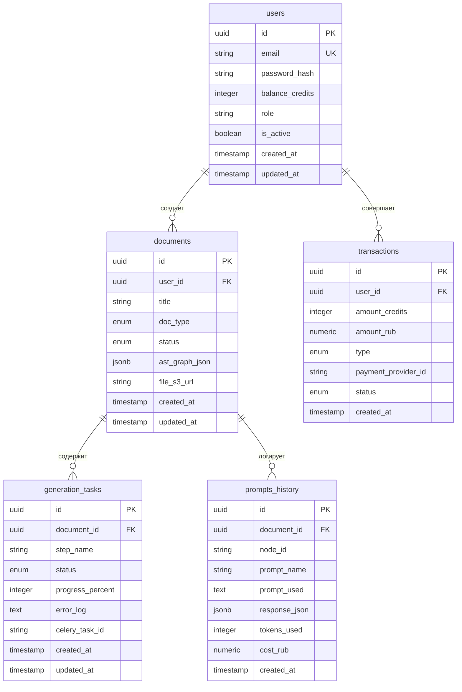

# Архитектура Базы Данных и Хранения (DB_SCHEMA.md)

Настоящий документ определяет архитектуру базы данных PostgreSQL, DDL-скрипты, ORM-модели (SQLAlchemy 2.0 async / Asyncpg для FastAPI Backend) и Pydantic v2 / Zod схемы для проекта **AI GostDoc**.

---

## 1. Стек работы с данными (Data Stack)
* **Backend API & Worker:** FastAPI (Python 3.11+) + SQLAlchemy 2.0 Async + Pydantic v2.
* **Frontend:** React (Vite / TypeScript) + Zod + Axios / Fetch.
* **База данных:** PostgreSQL 15+ (Асинхронный драйвер Asyncpg, миграции Alembic).
* **Кэш и воркеры:** Redis + Celery.

---

## 2. Схема сущностей и связей (ER Diagram)



---

## 3. PostgreSQL DDL Скрипт (Data Definition Language)

```sql
-- Включение расширения для генерации UUID
CREATE EXTENSION IF NOT EXISTS "uuid-ossp";

-- 1. Типы ENUM
CREATE TYPE user_role AS ENUM ('user', 'admin');
CREATE TYPE doc_type_enum AS ENUM ('coursework', 'abstract', 'vkr');
CREATE TYPE doc_status_enum AS ENUM ('draft', 'outline_generated', 'generating', 'completed', 'failed');
CREATE TYPE task_status_enum AS ENUM ('pending', 'processing', 'completed', 'failed');
CREATE TYPE transaction_type_enum AS ENUM ('topup', 'spend_generation', 'spend_spot_regen', 'refund');
CREATE TYPE transaction_status_enum AS ENUM ('pending', 'succeeded', 'canceled');

-- 2. Таблица пользователей (users)
CREATE TABLE users (
    id UUID PRIMARY KEY DEFAULT uuid_generate_v4(),
    email VARCHAR(255) NOT NULL UNIQUE,
    password_hash VARCHAR(255) NOT NULL,
    balance_credits INT NOT NULL DEFAULT 10 CHECK (balance_credits >= 0),
    role user_role NOT NULL DEFAULT 'user',
    is_active BOOLEAN NOT NULL DEFAULT TRUE,
    created_at TIMESTAMP WITH TIME ZONE DEFAULT CURRENT_TIMESTAMP NOT NULL,
    updated_at TIMESTAMP WITH TIME ZONE DEFAULT CURRENT_TIMESTAMP NOT NULL
);

CREATE INDEX idx_users_email ON users(email);

-- 3. Таблица документов (documents)
CREATE TABLE documents (
    id UUID PRIMARY KEY DEFAULT uuid_generate_v4(),
    user_id UUID NOT NULL REFERENCES users(id) ON DELETE CASCADE,
    title VARCHAR(500) NOT NULL,
    doc_type doc_type_enum NOT NULL DEFAULT 'coursework',
    status doc_status_enum NOT NULL DEFAULT 'draft',
    ast_graph_json JSONB DEFAULT '{}'::jsonb NOT NULL,
    file_s3_url VARCHAR(1000),
    created_at TIMESTAMP WITH TIME ZONE DEFAULT CURRENT_TIMESTAMP NOT NULL,
    updated_at TIMESTAMP WITH TIME ZONE DEFAULT CURRENT_TIMESTAMP NOT NULL
);

CREATE INDEX idx_documents_user_id ON documents(user_id);
CREATE INDEX idx_documents_status ON documents(status);
CREATE INDEX idx_documents_ast_json ON documents USING gin(ast_graph_json);

-- 4. Таблица задач фоновой генерации (generation_tasks)
CREATE TABLE generation_tasks (
    id UUID PRIMARY KEY DEFAULT uuid_generate_v4(),
    document_id UUID NOT NULL REFERENCES documents(id) ON DELETE CASCADE,
    step_name VARCHAR(100) NOT NULL,
    status task_status_enum NOT NULL DEFAULT 'pending',
    progress_percent INT NOT NULL DEFAULT 0 CHECK (progress_percent BETWEEN 0 AND 100),
    error_log TEXT,
    celery_task_id VARCHAR(255),
    created_at TIMESTAMP WITH TIME ZONE DEFAULT CURRENT_TIMESTAMP NOT NULL,
    updated_at TIMESTAMP WITH TIME ZONE DEFAULT CURRENT_TIMESTAMP NOT NULL
);

CREATE INDEX idx_tasks_document_id ON generation_tasks(document_id);
CREATE INDEX idx_tasks_celery_id ON generation_tasks(celery_task_id);

-- 5. Таблица истории промптов (prompts_history)
CREATE TABLE prompts_history (
    id UUID PRIMARY KEY DEFAULT uuid_generate_v4(),
    document_id UUID NOT NULL REFERENCES documents(id) ON DELETE CASCADE,
    node_id VARCHAR(100),
    prompt_name VARCHAR(100) NOT NULL,
    prompt_used TEXT NOT NULL,
    response_json JSONB DEFAULT '{}'::jsonb NOT NULL,
    tokens_used INT DEFAULT 0 NOT NULL,
    cost_rub NUMERIC(10, 4) DEFAULT 0.0000 NOT NULL,
    created_at TIMESTAMP WITH TIME ZONE DEFAULT CURRENT_TIMESTAMP NOT NULL
);

CREATE INDEX idx_prompts_doc_id ON prompts_history(document_id);
CREATE INDEX idx_prompts_node_id ON prompts_history(node_id);

-- 6. Таблица транзакций и платежей (transactions)
CREATE TABLE transactions (
    id UUID PRIMARY KEY DEFAULT uuid_generate_v4(),
    user_id UUID NOT NULL REFERENCES users(id) ON DELETE CASCADE,
    amount_credits INT NOT NULL,
    amount_rub NUMERIC(10, 2) NOT NULL DEFAULT 0.00,
    type transaction_type_enum NOT NULL,
    payment_provider_id VARCHAR(255),
    status transaction_status_enum NOT NULL DEFAULT 'pending',
    created_at TIMESTAMP WITH TIME ZONE DEFAULT CURRENT_TIMESTAMP NOT NULL
);

CREATE INDEX idx_transactions_user_id ON transactions(user_id);
CREATE INDEX idx_transactions_provider_id ON transactions(payment_provider_id);
```

---

## 4. ORM Модели FastAPI Backend (SQLAlchemy 2.0 Async)

```python
import uuid
from datetime import datetime
from enum import Enum
from typing import Optional, List, Dict, Any

from sqlalchemy import (
    String, Integer, Boolean, Text, Numeric, DateTime, ForeignKey, Enum as SQLEnum
)
from sqlalchemy.dialects.postgresql import UUID, JSONB
from sqlalchemy.orm import DeclarativeBase, Mapped, mapped_column, relationship

class Base(DeclarativeBase):
    pass

class UserRole(str, Enum):
    USER = "user"
    ADMIN = "admin"

class DocType(str, Enum):
    COURSEWORK = "coursework"
    ABSTRACT = "abstract"
    VKR = "vkr"

class DocStatus(str, Enum):
    DRAFT = "draft"
    OUTLINE_GENERATED = "outline_generated"
    GENERATING = "generating"
    COMPLETED = "completed"
    FAILED = "failed"

class TaskStatus(str, Enum):
    PENDING = "pending"
    PROCESSING = "processing"
    COMPLETED = "completed"
    FAILED = "failed"

class TransactionType(str, Enum):
    TOPUP = "topup"
    SPEND_GENERATION = "spend_generation"
    SPEND_SPOT_REGEN = "spend_spot_regen"
    REFUND = "refund"

class TransactionStatus(str, Enum):
    PENDING = "pending"
    SUCCEEDED = "succeeded"
    CANCELED = "canceled"

class User(Base):
    __tablename__ = "users"

    id: Mapped[uuid.UUID] = mapped_column(UUID(as_uuid=True), primary_key=True, default=uuid.uuid4)
    email: Mapped[str] = mapped_column(String(255), unique=True, nullable=False, index=True)
    password_hash: Mapped[str] = mapped_column(String(255), nullable=False)
    balance_credits: Mapped[int] = mapped_column(Integer, default=10, nullable=False)
    role: Mapped[UserRole] = mapped_column(SQLEnum(UserRole), default=UserRole.USER, nullable=False)
    is_active: Mapped[bool] = mapped_column(Boolean, default=True, nullable=False)
    created_at: Mapped[datetime] = mapped_column(DateTime(timezone=True), default=datetime.utcnow, nullable=False)
    updated_at: Mapped[datetime] = mapped_column(DateTime(timezone=True), default=datetime.utcnow, onupdate=datetime.utcnow, nullable=False)

    documents: Mapped[List["Document"]] = relationship("Document", back_populates="user", cascade="all, delete-orphan")
    transactions: Mapped[List["Transaction"]] = relationship("Transaction", back_populates="user", cascade="all, delete-orphan")

class Document(Base):
    __tablename__ = "documents"

    id: Mapped[uuid.UUID] = mapped_column(UUID(as_uuid=True), primary_key=True, default=uuid.uuid4)
    user_id: Mapped[uuid.UUID] = mapped_column(UUID(as_uuid=True), ForeignKey("users.id", ondelete="CASCADE"), nullable=False, index=True)
    title: Mapped[str] = mapped_column(String(500), nullable=False)
    doc_type: Mapped[DocType] = mapped_column(SQLEnum(DocType), default=DocType.COURSEWORK, nullable=False)
    status: Mapped[DocStatus] = mapped_column(SQLEnum(DocStatus), default=DocStatus.DRAFT, nullable=False, index=True)
    ast_graph_json: Mapped[Dict[str, Any]] = mapped_column(JSONB, default=dict, nullable=False)
    file_s3_url: Mapped[Optional[str]] = mapped_column(String(1000), nullable=True)
    created_at: Mapped[datetime] = mapped_column(DateTime(timezone=True), default=datetime.utcnow, nullable=False)
    updated_at: Mapped[datetime] = mapped_column(DateTime(timezone=True), default=datetime.utcnow, onupdate=datetime.utcnow, nullable=False)

    user: Mapped["User"] = relationship("User", back_populates="documents")
    tasks: Mapped[List["GenerationTask"]] = relationship("GenerationTask", back_populates="document", cascade="all, delete-orphan")
    prompts: Mapped[List["PromptHistory"]] = relationship("PromptHistory", back_populates="document", cascade="all, delete-orphan")

class GenerationTask(Base):
    __tablename__ = "generation_tasks"

    id: Mapped[uuid.UUID] = mapped_column(UUID(as_uuid=True), primary_key=True, default=uuid.uuid4)
    document_id: Mapped[uuid.UUID] = mapped_column(UUID(as_uuid=True), ForeignKey("documents.id", ondelete="CASCADE"), nullable=False, index=True)
    step_name: Mapped[str] = mapped_column(String(100), nullable=False)
    status: Mapped[TaskStatus] = mapped_column(SQLEnum(TaskStatus), default=TaskStatus.PENDING, nullable=False)
    progress_percent: Mapped[int] = mapped_column(Integer, default=0, nullable=False)
    error_log: Mapped[Optional[str]] = mapped_column(Text, nullable=True)
    celery_task_id: Mapped[Optional[str]] = mapped_column(String(255), nullable=True, index=True)
    created_at: Mapped[datetime] = mapped_column(DateTime(timezone=True), default=datetime.utcnow, nullable=False)
    updated_at: Mapped[datetime] = mapped_column(DateTime(timezone=True), default=datetime.utcnow, onupdate=datetime.utcnow, nullable=False)

    document: Mapped["Document"] = relationship("Document", back_populates="tasks")

class PromptHistory(Base):
    __tablename__ = "prompts_history"

    id: Mapped[uuid.UUID] = mapped_column(UUID(as_uuid=True), primary_key=True, default=uuid.uuid4)
    document_id: Mapped[uuid.UUID] = mapped_column(UUID(as_uuid=True), ForeignKey("documents.id", ondelete="CASCADE"), nullable=False, index=True)
    node_id: Mapped[Optional[str]] = mapped_column(String(100), nullable=True, index=True)
    prompt_name: Mapped[str] = mapped_column(String(100), nullable=False)
    prompt_used: Mapped[str] = mapped_column(Text, nullable=False)
    response_json: Mapped[Dict[str, Any]] = mapped_column(JSONB, default=dict, nullable=False)
    tokens_used: Mapped[int] = mapped_column(Integer, default=0, nullable=False)
    cost_rub: Mapped[float] = mapped_column(Numeric(10, 4), default=0.0000, nullable=False)
    created_at: Mapped[datetime] = mapped_column(DateTime(timezone=True), default=datetime.utcnow, nullable=False)

    document: Mapped["Document"] = relationship("Document", back_populates="prompts")

class Transaction(Base):
    __tablename__ = "transactions"

    id: Mapped[uuid.UUID] = mapped_column(UUID(as_uuid=True), primary_key=True, default=uuid.uuid4)
    user_id: Mapped[uuid.UUID] = mapped_column(UUID(as_uuid=True), ForeignKey("users.id", ondelete="CASCADE"), nullable=False, index=True)
    amount_credits: Mapped[int] = mapped_column(Integer, nullable=False)
    amount_rub: Mapped[float] = mapped_column(Numeric(10, 2), default=0.00, nullable=False)
    type: Mapped[TransactionType] = mapped_column(SQLEnum(TransactionType), nullable=False)
    payment_provider_id: Mapped[Optional[str]] = mapped_column(String(255), nullable=True, index=True)
    status: Mapped[TransactionStatus] = mapped_column(SQLEnum(TransactionStatus), default=TransactionStatus.PENDING, nullable=False)
    created_at: Mapped[datetime] = mapped_column(DateTime(timezone=True), default=datetime.utcnow, nullable=False)

    user: Mapped["User"] = relationship("User", back_populates="transactions")
```

---

## 5. Pydantic v2 Схемы (FastAPI Request/Response Schemas)

```python
from pydantic import BaseModel, EmailStr, Field, ConfigDict
from uuid import UUID
from datetime import datetime
from typing import Optional, Dict, Any, List

class UserRead(BaseModel):
    id: UUID
    email: EmailStr
    balance_credits: int
    role: str
    is_active: bool
    created_at: datetime

    model_config = ConfigDict(from_attributes=True)

class DocumentCreate(BaseModel):
    title: str = Field(..., min_length=3, max_length=500)
    doc_type: str = Field("coursework", description="coursework | abstract | vkr")

class DocumentRead(BaseModel):
    id: UUID
    user_id: UUID
    title: str
    doc_type: str
    status: str
    ast_graph_json: Dict[str, Any]
    file_s3_url: Optional[str] = None
    created_at: datetime
    updated_at: datetime

    model_config = ConfigDict(from_attributes=True)

class SpotRegenerateRequest(BaseModel):
    document_id: UUID
    node_id: str = Field(..., description="ID узла AST для перегенерации")
    user_instruction: Optional[str] = Field(None, description="Уточнение пользователя")

class TaskRead(BaseModel):
    id: UUID
    document_id: UUID
    step_name: str
    status: str
    progress_percent: int
    error_log: Optional[str] = None
    created_at: datetime

    model_config = ConfigDict(from_attributes=True)
```
