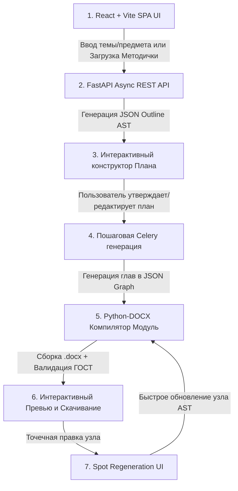

# Product Requirement Document (PRD) — GOST Academic DOCX Generator

## 1. Обзор продукта (Product Overview)

### 1.1. Название и Миссия
**GOST Academic AI Generator** — высоколокализованный SaaS-сервис автоматической генерации академических работ (курсовые работы, рефераты, ВКР) с идеальным компилированием в файл `.docx` по требованиям ГОСТ РФ.

### 1.2. Технологический Стек (Tech Stack)
* **Frontend:** React (v18+), Vite, TypeScript, Tailwind CSS, Shadcn UI, Framer Motion, Zustand.
* **Backend API & Orchestration:** FastAPI (Python 3.11+), Pydantic v2, Uvicorn, Asyncpg, JWT (`python-jose`/`passlib`).
* **DOCX Engine & Async Workers:** Python 3.11+, `python-docx`, Celery, Redis.
* **Database & Caching:** PostgreSQL 15+ (SQLAlchemy 2.0 async, Alembic), Redis (State persistence & Celery Broker).
* **LLM Integration:** OpenAI API / DeepSeek API / OpenRouter (`httpx` / `openai` SDK).

### 1.3. Основная проблема
* **Студенческая рутина:** Копирование текста из ChatGPT / Claude в MS Word ломает форматирование. Настройка полей, шрифтов, абзацных отступов (1.25 см), межстрочных интервалов (1.5), заголовков и списков занимает от 3 до 8 часов.
* **Галлюцинации и поверхностность LLM:** Обычные промпты выдают общие фразы без структуры, таблицы "плывут", а список литературы содержит несуществующие источники.

### 1.4. Ключевое решение и Инсайт
**Жесткое разделение ответственности в едином Python-экопространстве:**
1. **FastAPI & LLM Pipeline Layer:** Отвечает за REST API, авторизацию, платежи, пошаговую промпт-оркестрацию LLM и управление валидированным **JSON Graph AST** (Abstract Syntax Tree) через Pydantic v2.
2. **Deterministic DOCX Compiler Layer:** Единый модуль на `python-docx`, который нативно вызывается Python-воркером Celery и превращает JSON Graph AST в итоговый `.docx` со 100% математическим соблюдением стандартов ГОСТ.

---

## 2. Пользовательские сценарии (User Journey & Flow)

### 2.1. Пошаговое описание UX (Wizard Steps)
1. **Шаг 1: Ввод исходных данных (React + Vite)**
   * Пользователь вводит Тему работы, Предмет, Тип (Курсовая / Реферат / ВКР).
   * Выбирает целевой объем (кол-во страниц / 2 или 3 главы).
   * *Опционально:* Загружает методичку (`.pdf`, `.docx`).
2. **Шаг 2: Парсинг и формирование AST-Плана (Outline Construction)**
   * AI парсит требования методички и генерирует подробное дерево Плана (`ChapterNode`, `SectionNode`).
   * Пользователь видит визуальный React Tree UI: может переименовывать подзаголовки, менять их местами.
3. **Шаг 3: Утверждение плана и запуск генерации**
   * Нажатие "Утвердить план" отправляет запрос на FastAPI Backend, проверяется баланс кредитов и запускается фоновая задача Celery.
   * Пользователь в реальном времени видит progress-bar через SSE / WebSocket с FastAPI.
4. **Шаг 4: Компиляция DOCX и предпросмотр**
   * Celery воркер вызывает модуль `python-docx` компилятора прямо внутри Python-окружения.
   * В браузере отображается предпросмотр страниц формата А4.
5. **Шаг 5: Оплата и Скачивание**
   * Пользователь скачивает идеальный файл `.docx`.

---

## 3. Новые Ключевые UX-Сценарии и Фичи

### 3.1. Spot Regeneration (Точечная перегенерация узлов)
* **Принцип работы:** В React-интерфейсе предпросмотра/редактирования AST у каждого узла есть кнопка *"Перегенерировать узел"*.
* **Контекстный промпт:** Пользователь может ввести уточнение: *"Добавь статистику за 2024 год"*.
* **FastAPI Handler:** Извлекает `node_id` и передает контекст соседних узлов в LLM.
* **Быстрая перекомпиляция:** Нативный модуль `python-docx` пересобирает `.docx` за 1.5 секунды.

### 3.2. Обработка Сетевых Сбоев и Rate Limits (Retry Policy & Redis State Saving)
* **Redis State Checkpointing:** Каждая успешная фаза генерации сохраняется FastAPI / Celery в Redis (`key: doc:{doc_id}:checkpoint`).
* **Retry Policy (Exponential Backoff):** При 429/503 ошибках LLM API выполняются повторы через `tenacity` (2s, 4s, 8s, 16s...).
* **Failover Provider:** Автоматическое переключение на резервную модель.
* **Возобновление генерации:** Возможность продолжить генерацию с последнего сохраненного чекпоинта в Redis.

### 3.3. Интеграция Эквайринга (ЮKassa / CloudPayments) и Биллинговая Система
* **Биллинговая модель:** Баланс кредитов в PostgreSQL (управляемый FastAPI + SQLAlchemy 2.0).
* **Оплата:** Интеграция ЮKassa / CloudPayments с обработкой Signed Webhooks в FastAPI (`POST /api/v1/payments/webhook`).

---

## 4. Требования к компонентам системы

### 4.1. Frontend (React + Vite + TypeScript)
* **Стек:** React 18+, Vite, TypeScript, Tailwind CSS, Shadcn UI, Framer Motion, Zustand.
* **Wizard UI:** Пошаговая форма с состоянием в Zustand.
* **Outline & Node Editor:** Древовидный редактор структуры с кнопками точечной перегенерации.
* **Web DOCX Viewer:** Эмуляция страниц А4 по ГОСТ.

### 4.2. Backend (FastAPI + Python 3.11+)
* **Стек:** FastAPI, Uvicorn, Pydantic v2, SQLAlchemy 2.0 (Asyncpg), Celery, Redis.
* **Обязанности:** REST API, WebSocket/SSE, авторизация, платежи, промпт-оркестрация и нативная компиляция `.docx`.

---

## 5. Нефункциональные требования (NFR)

1. **Скорость генерации:** Полный цикл < 120–180 секунд. Spot regeneration < 5 секунд.
2. **Точность ГОСТ:** 100% совпадение стилей и полей в MS Word.
3. **Оригинальность:** Высокий процент уникальности текста.
4. **Масштабируемость:** Единая Python-экосистема (FastAPI + Celery) легко масштабируется горизонтально.
