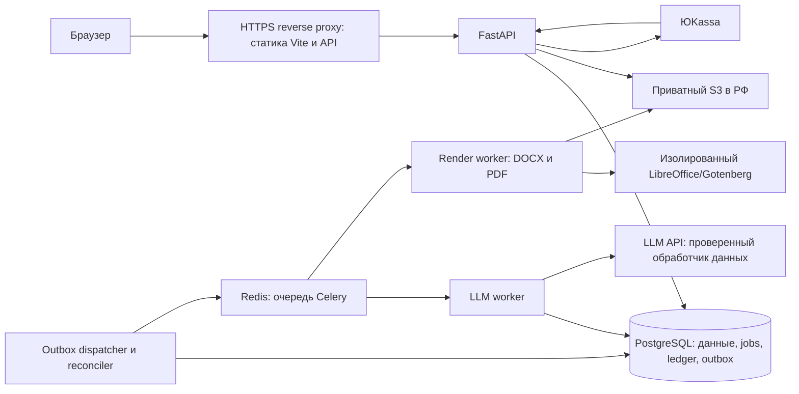

# 02. Архитектура и сценарии

> Актуальный MVP: [summary.md](summary.md), [рефералка/прогресс](10-referrals-and-progress.md), [зарубежные API/бесплатный тест](11-foreign-api-and-free-prototype.md) приоритетнее этого расширенного документа. Реферальный бонусный баланс обязателен; покупка кредитов/промокоды не нужны. Российские LLM исключены. Старые предложения по paid wallet, S3 работ, PDF и масштабированию отложены. Аудит безопасности и применимые юридические обязанности сохраняются.

## Минимальная схема

Это один кодовый проект с модулями auth, documents, jobs, rendering, billing, payments, storage, legal/audit. Отдельные процессы API и worker не означают микросервисную архитектуру. Docker Compose на одной машине. PostgreSQL/Redis/Gotenberg не публиковать наружу. Статический frontend и `/api` обслуживать с одного домена.

На малой нагрузке периодический dispatcher/reconciler может быть одним cron-процессом с блокировкой. Celery уже есть, поэтому не менять его на самописную очередь ради удаления одного контейнера. PostgreSQL — источник истины: Redis можно восстановить и повторно наполнить из outbox/jobs.

## Пользовательский путь

1. Гость видит демо и стоимость. Для реальной генерации регистрируется, подтверждает email; бесплатный доступ только по приглашению/квоте.
2. Создаёт **черновик**, который сохраняется без полной генерации. Загружает методичку при включённой безопасной обработке файлов; иначе функция скрыта.
3. Запрашивает план в пределах квоты. План — отдельная версия. Пользователь редактирует и явно утверждает его. Изменение после утверждения создаёт новую версию.
4. API выдаёт quote: цена в кредитах/рублях, ограничения страниц и включённых исправлений, версия тарифа, срок действия. Сервер проверяет баланс или предлагает оплату пакета.
5. При запуске сервер одним commit создаёт reservation, immutable input snapshot, job и outbox. Возвращает `202 job_id`. Повтор с тем же idempotency key возвращает тот же job.
6. Worker берёт lease и генерирует разделы утверждённого плана; валидирует и сохраняет каждый успешный раздел. Прогресс берётся из БД.
7. Render worker создаёт DOCX и PDF одной версии, загружает, проверяет артефакты. Только затем job становится ready и резерв превращается в окончательное списание.
8. При окончательном сбое резерв освобождается один раз. Внутренние затраты LLM остаются расходом сервиса. Технический retry не является новой покупкой.
9. Пользователь возвращается с другого устройства, видит те же работы, версии и файлы. Изменение раздела создаёт новую версию, старый результат остаётся доступен.

## Состояния и гарантии

Документ: `draft → outline_pending → outline_ready → approved → generating → rendering → ready`; ветки `failed`, `canceled`, `deleting`, `deleted`. Работа может иметь старую ready-версию, пока новая находится в generating.

Job: `queued → running → retry_wait → running → succeeded|failed|canceled`. Внутри хранить шаги и node IDs. `ready` нельзя ставить по таймеру или только по готовности текста. Лимит один активный изменяющий job на документ, в бете один на пользователя.

Доставка Celery как минимум однократная; обещание exactly-once не даём. Эффект в БД идемпотентен через уникальные ключи, compare-and-swap версии и lease с fencing token. После истечения lease старый worker не может записать результат. Внешний LLM при сетевом таймауте может быть оплачен дважды: снизить риск checkpointing и ограничением retry, не скрывать эту неопределённость.

Outbox закрывает разрыв между commit и публикацией: `operation_id` уникален, dispatcher публикует до подтверждения, повторная публикация безопасна. Lease, attempts, next_attempt_at и heartbeat сохраняются в PostgreSQL. Watchdog находит зависшие jobs, сверяет шаги и возобновляет/завершает их. Не держать SQL transaction и row lock во время HTTP-вызова LLM или эквайера.

## Предлагаемый контракт API

Все пути относительно `/api/v1`; это **целевой контракт**, текущий код ему ещё не соответствует.

| Метод/путь | Семантика |
|---|---|
| POST `/auth/register`, `/auth/login`, `/auth/logout` | Регистрация/создание/отзыв cookie-сессии |
| POST `/auth/verify-email`, `/auth/forgot-password`, `/auth/reset-password` | Одноразовые токены, нейтральные ответы |
| GET/PATCH `/me` | Безопасные поля профиля и defaults титульного листа |
| GET/DELETE `/me/sessions/{id}` | Управление собственными устройствами |
| POST/GET `/documents` | Черновик и список с cursor pagination, без AST в списке |
| GET/PATCH/DELETE `/documents/{id}` | Owner scope, `If-Match`/revision для изменения |
| POST `/documents/{id}/outline-jobs` | Асинхронный план |
| PUT `/documents/{id}/outline` | Сохранение правок с revision |
| POST `/documents/{id}/approve` | Фиксация плана и input version |
| POST `/documents/{id}/quote` | Серверная цена/лимиты |
| POST `/documents/{id}/generation-jobs` | Запуск по quote + idempotency key |
| POST `/documents/{id}/regeneration-jobs` | node_id, base_revision, instruction, quote |
| POST `/jobs/{id}/cancel`, `/jobs/{id}/retry` | Разрешённые переходы; retry того же job без повторной оплаты |
| GET `/jobs/{id}` | Сохранённый прогресс, безопасный код ошибки, ожидаемая очередь |
| GET `/documents/{id}/files/{file_id}/download` | Проверка владельца → short-lived download URL |
| POST `/uploads` | Ограниченная загрузка/карантин; status до использования |
| GET `/catalog`, `/wallet`, `/wallet/entries` | Тарифы и серверная история с pagination |
| POST `/orders`, GET `/orders/{id}` | Покупка выбранного server-side product_id |
| POST `/payments/yookassa/webhook` | Provider-specific проверка, inbox, сверка |
| POST `/refund-requests` | Зарегистрировать претензию/запрос возврата |

Idempotency key scoped по user+route, хранить hash тела: тот же ключ с другим телом → 409. Уникальность запуска дополняется ограничением active job, потому что клиент может прислать новый ключ. Финансовые ключи хранить вместе с операцией, не удалять коротким общим TTL.

На MVP polling прогресса каждые 5 секунд только для активного job; при скрытой вкладке пауза/backoff. WS/SSE можно временно отключить до безопасной реализации. Если включать, cookie-auth, owner check до открытия, Origin check, reconnect с snapshot из БД, heartbeat и лимит подключений. Не передавать долгоживущий токен в query string.

Ошибки: `401` вход, `404` нет своей работы, `409` версия/конфликт/idempotency, `402` нехватка средств, `413` размер, `422` валидация, `429` квота + Retry-After, `503` временная недоступность. Ответ содержит `code`, безопасное `message`, `request_id`; stacktrace только в закрытых очищенных логах.
